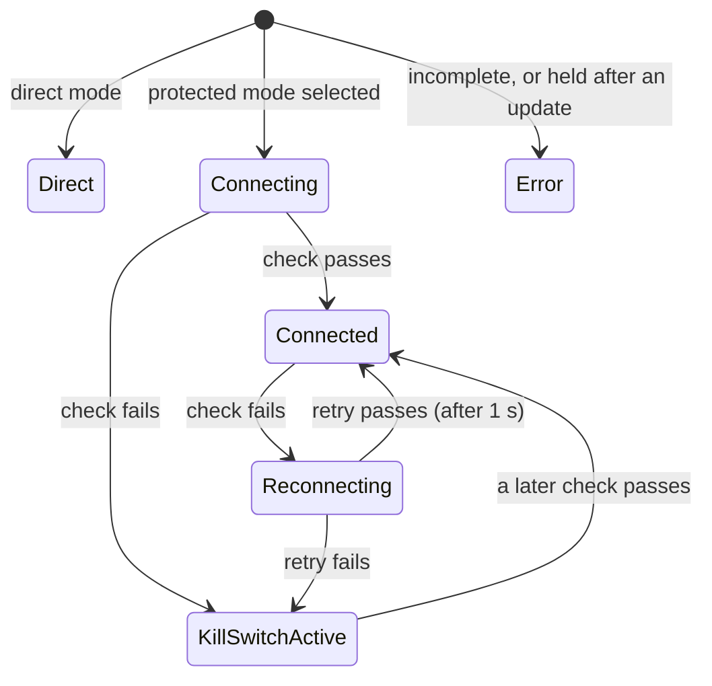
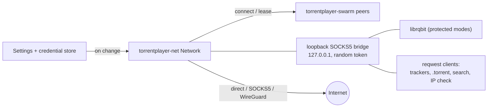

# Network modes and kill switch

> **Status:** direct, SOCKS5, and the built-in WireGuard tunnel work. The VPN adapter mode
> (binding to a VPN app's interface) was removed in 0.3.0; see
> [ADR 0009](adr/0009-remove-vpn-adapter-mode.md) and [Using a VPN app](#using-a-vpn-app).
> Protected modes keep the kill switch engaged until their connection is verified.
> Code: `crates/torrentplayer-net`.

## The invariant

> If a proxy or tunnel is selected, **no traffic leaves through any other path.**
> TorrentPlayer never falls back to a direct connection.

Every outbound connection TorrentPlayer makes for torrents, trackers, `.torrent` downloads, search, and
the connection check asks `torrentplayer_net::Network` first. In a protected mode (anything but
direct), connections are refused until the mode is verified, and whenever a health check fails.
Existing connections are closed at the same moment. DHT and UDP trackers use leased sockets
through the WireGuard tunnel or the SOCKS5 UDP ASSOCIATE relay
(`Network::udp_socket`). librqbit's own unscoped UDP (DHT, uTP, its UDP tracker client) stays
off in protected modes. A separate scoped DHT transport supplies peers without opening a
native socket. WireGuard datagrams and bootstrap DNS use the application-local tunnel.

The webview cannot reach the network itself: its CSP allows only `ipc:` and the loopback stream
server (as media, and with `fetch` for converted audio). The FFmpeg sidecar that converts Dolby
and DTS audio reads only from a loopback server, with proxy variables removed from its
environment.

## Modes

| Mode                 | What happens                                                                                                                                                                                | Verified by (every 5 s)                                                                                     |
| -------------------- | ------------------------------------------------------------------------------------------------------------------------------------------------------------------------------------------- | ----------------------------------------------------------------------------------------------------------- |
| **Direct** (default) | No proxy or tunnel. No kill switch. With a VPN app connected on the computer, traffic goes through it (see [Using a VPN app](#using-a-vpn-app)).                                            | Nothing.                                                                                                    |
| **SOCKS5 proxy**     | Every TCP connection goes through the proxy (RFC 1928), with optional username and password (RFC 1929). Host names are resolved by the proxy unless "Resolve DNS through the proxy" is off. | A TCP connection to the proxy plus the method negotiation and login. No connection is requested through it. |
| **WireGuard**        | TCP and DNS run inside an application-local WireGuard tunnel using the imported configuration. No OS routes or adapters are changed.                                                        | A handshake under 180 s old, and replies to traffic (see [WireGuard health](#wireguard-health)).            |

A protected mode with incomplete settings (a proxy without a host, a username whose password is
missing from the credential store, no WireGuard configuration) is also `Error`: blocked, with the
reason shown, until the settings are fixed.

## What each kind of traffic does

| Traffic                                 | Direct                                                                    | SOCKS5 proxy                                   | Kill switch engaged   |
| --------------------------------------- | ------------------------------------------------------------------------- | ---------------------------------------------- | --------------------- |
| Peers over TCP, torrentplayer-swarm     | direct                                                                    | through the proxy                              | refused, closed       |
| Peers over TCP, librqbit (rqbit engine) | direct                                                                    | via the loopback bridge, through the proxy     | refused, closed       |
| Peers over uTP (librqbit)               | when listening                                                            | **off**                                        | off                   |
| Incoming peer connections               | when turned on: every interface (see [below](#incoming-peer-connections)) | **never**                                      | closed                |
| HTTP(S) trackers                        | direct                                                                    | through the proxy (proxy DNS, see [DNS](#dns)) | refused               |
| UDP trackers                            | direct                                                                    | UDP ASSOCIATE relay                            | refused               |
| DHT discovery                           | on                                                                        | UDP ASSOCIATE relay (when enabled)             | off                   |
| Local peer discovery (multicast)        | off                                                                       | off                                            | off                   |
| `.torrent` file downloads               | direct                                                                    | through the proxy                              | refused               |
| Search (search.emberglow.tech)          | direct                                                                    | through the proxy                              | refused               |
| Public-IP check (icanhazip.com)         | direct                                                                    | through the proxy                              | refused, nothing sent |

"Off" means the traffic is not sent at all, never sent around the mode. WireGuard also carries
DHT and UDP trackers inside its tunnel. In protected modes, peers found by scoped DHT and UDP
trackers bootstrap librqbit's magnet metadata lookup; torrentplayer-swarm continues discovery while
streaming. Trackerless magnets can therefore find peers too: the DHT hands the metadata lookup
up to 200 peers (those it finds within 2 seconds of the first), since many DHT addresses are
stale and librqbit gets no others in these modes. Protected-mode DHT nodes never
load or save the routing tables kept between runs in Direct mode (see
[Configuration](configuration.md#where-settings-are-stored)), so their node id cannot link the
two. A TCP-only SOCKS5 proxy cannot
provide these UDP paths: HTTP trackers and peer exchange still work, but UDP failures never
trigger a direct fallback. `.torrent` files work through torrentplayer-swarm.

torrentplayer-swarm paces its DHT lookups by what each torrent needs, in every mode. A lookup
starts as soon as a torrent is added and ends by itself, usually within 15 seconds; every
address it finds goes to the torrent as it arrives. The next one follows 20 seconds later while
the torrent downloads with fewer live peers than half its peer limit (doubling, up to
5 minutes, while lookups find fewer than 10 new addresses), every 5 minutes once it has
enough, and never while it is paused or has nothing to download, except every 15 minutes to
renew its announcement while it announces itself (see
[Incoming peer connections](#incoming-peer-connections)). A paused torrent that resumes, or one
that starts playing, looks up within 5 seconds.

In SOCKS5 mode, turning off "Send tracker requests through the proxy" turns trackers off
entirely for that mode; trackers are never contacted directly.
The separate "DHT through the proxy" switch controls DHT, independently of trackers.

**SOCKS5 UDP lifetime.** Each association keeps its authenticated TCP control connection alive.
The OS UDP socket is connected only to the negotiated relay, not the destination. A closed
control connection or revoked network lease stops send and receive operations. Invalid reserved
bytes, fragmented envelopes, domain-addressed replies, and truncated envelopes are dropped.
For remote DNS, domain requests go to the proxy; DHT bootstrap pings learn the resolved public
address from a matching reply without a local target-name lookup. Learned DHT nodes and peers,
and UDP tracker reply sources, are checked against the public-address policy.

## Incoming peer connections

By default TorrentPlayer only connects out: it opens no listening port, so no firewall prompt
appears, at the cost of fewer peers and less upload. **Settings → Network & VPN → Accept
incoming peer connections** (`network.incomingPeers`) opens one TCP port, but only on the path
the selected mode allows. The listener belongs to `torrentplayer_net::Network`
(`Network::set_incoming`, `Network::incoming_peers`), so it follows the same kill switch and
epochs as outgoing connections.

| Mode             | Where TorrentPlayer listens                                                                                                                      |
| ---------------- | ------------------------------------------------------------------------------------------------------------------------------------------------ |
| **Direct**       | Every interface (`0.0.0.0` and `[::]`). Optionally a UPnP port mapping on the router.                                                            |
| **WireGuard**    | Only the tunnel's own addresses, inside TorrentPlayer's userspace tunnel. Nothing listens on the machine's interfaces.                           |
| **SOCKS5 proxy** | **Nowhere.** A proxy cannot accept arbitrary incoming connections for a client, and listening anywhere else would bypass it. The status says so. |

- **The kill switch closes it.** While traffic is blocked (connecting, reconnecting, kill switch,
  error) nothing listens. Each new epoch (a mode change, the kill switch lifting) reopens it on
  the new path. Every accepted connection carries a `Lease` for
  its epoch and is closed with the outgoing ones. IPv6 is accepted in protected modes only with
  **IPv6 → Route through the tunnel**.
- **Port.** 1024–65535, or 0 (the default) for a random port from 10000–49151, chosen once and
  kept while TorrentPlayer runs (another one is tried if it is taken). A port in use is
  reported and retried every 30 seconds. Changing the port reopens the listener without
  closing any connection. Peers behind a VPN reach the port only if the provider forwards it to
  you; choose that forwarded port here. With a VPN app in Direct mode, the listener is on every
  interface, so the VPN app decides which networks reach it.
- **Engines.** torrentplayer-swarm reads the handshake of each accepted connection (at most 32
  at once, within the handshake timeout), hands it to the torrent it names, and serves it like
  an outgoing peer. Unknown torrents, paused torrents, our own peer id, and torrents at their
  peer limit (connected plus connecting) are refused. Trackers are told the listening port,
  and torrentplayer-swarm announces it in its DHT lookups (BEP 5 `announce_peer`, with the
  port itself rather than the DHT's UDP port) while the listener is open on it in the current
  mode: never in SOCKS5 mode, and in WireGuard mode only while the tunnel's listener is open.
  DHT nodes record the address they see, the VPN server's in WireGuard mode, so as with
  trackers the announcement brings peers only if the provider forwards the port. With incoming
  peers off, TorrentPlayer announces nothing to the DHT.
  librqbit listens itself only when it is the engine for every torrent (`advanced.engine` =
  `rqbit`) and only in direct mode, TCP only, on `[::]` (dual stack); its listener cannot be
  moved into a tunnel, so it never listens in a protected mode. With the automatic
  engine librqbit only fetches magnet metadata and never listens.
- **UPnP** (`network.incomingPeers.upnp`, off by default) asks the router to forward the port
  with UPnP IGD (`librqbit-upnp`), only in direct mode and only while listening. The mapping's
  lease is 60 seconds, renewed every 30, so it lapses within a minute after listening stops or
  the mode changes. NAT-PMP and PCP are not supported.
- **Status.** `NetworkStatus.incoming` is `off`, `idle` (no engine accepts them right now),
  `paused` (traffic blocked), `unsupported` (SOCKS5), `listening` (port, addresses, UPnP), or
  `failed` (the port could not be opened). Settings shows it under the connection state.

## Kill switch and connection state

| State              | Traffic | Meaning                                                              |
| ------------------ | ------- | -------------------------------------------------------------------- |
| `direct`           | allowed | Direct mode.                                                         |
| `connecting`       | blocked | A protected mode was just selected; the first check is running.      |
| `connected`        | allowed | The last check passed.                                               |
| `reconnecting`     | blocked | A check just failed; one quick retry follows.                        |
| `killSwitchActive` | blocked | The mode is not working. Checks continue; traffic resumes by itself. |
| `error`            | blocked | The mode cannot work (incomplete settings), or traffic is held.      |
| `disconnected`     | blocked | The app is closing.                                                  |

A connected SOCKS5 proxy must fail two checks in a row (the second one `retry_interval`, 1 s,
later) before the state leaves `connected`: one refused or slow check, common with providers
that cap connections (each check is one more), would otherwise close every connection.
Nothing goes around the proxy meanwhile; its own connections simply fail. A failed connection to
the proxy also triggers a check instead of waiting for the next interval, at most once per
interval, so a burst of failures does not become a burst of checks.

**Held traffic.** `NetworkConfig::hold` blocks all traffic, whatever the mode, with a reason:
the state is `error`, and the policy counts as protected, so librqbit starts behind the bridge
as it does in a protected mode. The app sets it while `network.hold` is set in Direct mode, which
loading does in two cases: settings migrated from the removed VPN adapter mode
(`vpnAdapterModeRemoved`), and a `settings.json` that exists but could not be read or parsed, or
whose network section or connection mode is invalid (`settingsUnreadable`, see
[Configuration](configuration.md#where-settings-are-stored)). Traffic is held until the user dismisses
the notice in Settings → Network & VPN or beside the status bar's indicator (or picks the
SOCKS5 or WireGuard mode, whose own kill switch then applies). A user who chose to send nothing
outside their VPN therefore never sends anything directly without confirming it first, even when
an update or a damaged file loses that choice.

**Epochs and leases.** Each change that could leave a connection on the wrong path (a new mode,
the kill switch engaging) starts a new epoch. Every
connection holds a `Lease` for the epoch it was made in and closes when it is revoked:
torrentplayer-swarm peers, and every connection relayed by the loopback bridge (pooled HTTP connections
included). In WireGuard mode the relay between the application's loopback stream and the tunnel
connection ends with the lease too, whether or not the application has closed its side. A
connection that finishes connecting after the epoch changed is dropped, and a host-name
connection checks its lease again before dialling each resolved address, so a direct route chosen
before a slow lookup is never used once the mode is protected.

**Recovery.** While traffic is blocked, torrentplayer-swarm does not attempt connections, so no peers are
used up. When traffic is allowed again it re-queues every known peer that is not connected and
restarts tracker announces under the new rules. librqbit's peers reconnect through the bridge.

**Events.** Mode changes, connects, losses, and recoveries are logged with timestamps (the last
50 are in `NetworkStatus.events`, never with secrets) and sent to the webview as
`network-status` events.

**In the UI.** The network indicator (bottom bar, and the player's status line) follows these
events: gray `Direct · no VPN`; green `Protected · <proxy or WireGuard endpoint>` when connected;
yellow `Connecting…` or `Reconnecting…`; red `Kill switch: traffic paused (<reason>)`,
`Network error: <reason>`, or (Direct mode, held) `Traffic paused: <reason>`. Its tooltip has the mode, endpoint, uptime (`connectedSinceMs`), and
the latest events; clicking it opens Settings → Network & VPN, which shows the same state with a **Try
again** button (`recheck_network`). When the kill switch pauses traffic and the video runs out
of data, the player says "VPN/proxy disconnected — traffic paused" instead of "Buffering…".

## How it is wired

- **torrentplayer-swarm** calls `Network::connect` for every peer and holds the lease.
- **HTTP clients** (`reqwest`) are pointed at the **loopback bridge** with `socks5h://`, so host
  names reach the bridge unresolved. The bridge is a SOCKS5 server on `127.0.0.1` that accepts
  only clients presenting a random per-run token (RFC 1929 password, compared in constant time),
  supports only `CONNECT`, and makes each connection with `Network::connect_host`. The clients
  are never rebuilt: the bridge follows mode changes and closes its connections when the epoch
  changes.
- **librqbit** cannot be pointed at a connector, so in protected modes it gets the bridge as its
  SOCKS5 proxy (`ConnectionOptions::proxy_url`), no native DHT, no listening socket (so no uTP or
  incoming connections; torrentplayer-swarm accepts those instead), and no local discovery. Its magnet links lose all their trackers before
  they are added, and the session contacts no trackers: its HTTP client could only use the bridge
  as `socks5://` (all its peer connector accepts), which resolves tracker names with the system
  resolver. TorrentPlayer announces to the HTTP and UDP trackers itself, through the mode (HTTP via
  the bridge with `socks5h://`), and with scoped DHT supplies the peers found as initial peers; the
  metadata handed to torrentplayer-swarm lists the trackers again. A tracker setting change therefore never
  needs librqbit restarted, and `.torrent` files are refused when librqbit is forced as the engine (their
  tracker lists cannot be filtered); with the automatic engine, `.torrent` files go to
  torrentplayer-swarm anyway. These session options are fixed at start, so when protection turns on or
  off `StreamEngine::apply_network` stops the librqbit session first (dropping its torrents),
  then switches; the next magnet link starts a new session.
- **Settings.** The app starts the network manager from the saved settings before anything
  connects, and re-applies them after every settings or secret change
  (`src-tauri/src/network.rs`). There is no separate apply command.

## DNS

| Mode      | Who resolves host names                                                                                                                                                                                                                                                                         |
| --------- | ----------------------------------------------------------------------------------------------------------------------------------------------------------------------------------------------------------------------------------------------------------------------------------------------- |
| Direct    | The system resolver. With a VPN app connected, where the query goes depends on the VPN app's DNS settings. **Not verified by TorrentPlayer.**                                                                                                                                                   |
| SOCKS5    | The proxy, for trackers (both engines), `.torrent` downloads, search, and the connection check (no DNS query leaves the machine). librqbit contacts no trackers in this mode; TorrentPlayer announces to them for it (see [How it is wired](#how-it-is-wired)).                                 |
| WireGuard | The configured DNS servers, contacted through the WireGuard tunnel. The system resolver is used only to bootstrap the VPN server endpoint. Missing DNS blocks host-name lookups without a direct fallback; this includes HTTP tracker names, which librqbit never resolves itself in this mode. |

## IPv6

In protected modes IPv6 destinations are refused unless "IPv6 through the tunnel" is chosen, so
IPv6 cannot bypass a VPN or proxy that only carries IPv4. In SOCKS5 mode with proxy DNS, the
proxy decides which address family it uses.

## WireGuard

`torrentplayer_net::WireGuardConfig::parse` reads `wg-quick` files strictly: `[Interface]` with
`PrivateKey` (base64, 32 bytes, not all zero), at least one `Address` (CIDR), optional `DNS`,
`MTU`, `ListenPort`; one or more `[Peer]` with `PublicKey`, optional `PresharedKey`, at least one
`AllowedIPs` range, an `Endpoint` (`host:port`, IPv6 in brackets), and optional
`PersistentKeepalive`. Keys are case-insensitive, comments start with `#`, files over 64 KiB are
refused. Script hooks (`PreUp`, `PostUp`, `PreDown`, `PostDown`) are reported as ignored and are
never run. Errors name the line but never repeat key material.

Some lines are accepted but have no effect, and the import says so:

- **DNS search domains** (names in `DNS`, as in `DNS = 10.64.0.1, corp.example`): only the server
  addresses are used; host names are always looked up in full.
- **`ListenPort`**: the app's tunnel always uses a random local port, chosen anew for each
  tunnel.
- **`PersistentKeepalive = off`** (or 0): the tunnel always sends a keepalive at least every
  25 seconds (the configured interval when one is set). Without it, the NAT mapping the server
  uses to reach this tunnel (forwarded ports, the server's own traffic) lapses while the tunnel
  is idle; the health probes, up to 80 s apart when idle, cannot keep it open. It costs one
  32-byte packet every 25 s.

The summary returned to the UI (`validate_wireguard_config`) has addresses, DNS, endpoints,
public keys, allowed ranges, and whether a preshared key exists, never the private or preshared
key. The Settings page shows it first; **Save configuration** then calls
`import_wireguard_config`, which parses the file again in Rust, stores the private key (and
preshared key, if any) in the OS credential store, and saves the rest in `network.wireguard`.
The keys never travel back to the webview, and only one `[Peer]` is accepted.

### Connecting inside TorrentPlayer

Choose **WireGuard** in Settings → Network & VPN, then import or paste the provider's `.conf`
file. Saving an imported configuration while this mode is selected starts the tunnel. **Connect**
checks it again immediately; selecting another mode closes the old tunnel and its connections.
The private key and optional preshared key are read from the OS credential store only in Rust.
Missing or invalid keys block traffic with an error. A successful authenticated handshake is
required before any application traffic is allowed, and the server must keep answering
traffic (see [WireGuard health](#wireguard-health)); otherwise the kill switch engages until it
answers again.

### WireGuard health

A WireGuard tunnel can fail in two ways that the transport itself never reports: the server
stops completing handshakes, or it keeps completing handshakes but answers no traffic (seen
with a provider's server that had stopped working: boringtun re-handshook every 15 seconds and
every tunneled DNS lookup failed). The check, every 5 seconds, reads the tunnel's own packet
timestamps (`tokio_wireguard::Interface::liveness`, added to the vendored copy) and uses
WireGuard's protocol timers:

| Rule                                                                                                                                                                                     | Why                                                                                                                                                                                                                                                                                                                      |
| ---------------------------------------------------------------------------------------------------------------------------------------------------------------------------------------- | ------------------------------------------------------------------------------------------------------------------------------------------------------------------------------------------------------------------------------------------------------------------------------------------------------------------------ |
| Without a current session (none yet, or the last handshake is 180 s old: REJECT_AFTER_TIME), a handshake must complete within the check's 5 s time limit.                                | Sessions expire after REJECT_AFTER_TIME; a handshake attempt is retried after REKEY_TIMEOUT (5 s). Reason: "the WireGuard server has not completed a recent handshake; check the endpoint and keys".                                                                                                                     |
| Traffic sent into the tunnel must get an authenticated packet back (data or a keepalive) within 20 s (`NetworkOptions::wireguard_reply_timeout`).                                        | A WireGuard peer that receives data and has nothing to send answers with a keepalive after KEEPALIVE_TIMEOUT (10 s); two REKEY_TIMEOUTs (5 s each) cover a session renewal at that moment. Handshake messages do not count. Reason: "the WireGuard server is not answering tunnel traffic; check the endpoint and keys". |
| A tunnel that has heard nothing (no data, keepalive, or handshake) for 10 s is probed. While it stays idle, the gap between probes doubles (10, 20, 40 s) up to 80 s; traffic resets it. | WireGuard is silent while idle, so an idle tunnel says nothing about the server. The probe is one tiny packet inside the tunnel (see below) that the server must answer.                                                                                                                                                 |

**The probe.** The server's WireGuard answers any data packet it decrypts within
KEEPALIVE_TIMEOUT, with a keepalive if nothing else, wherever the packet is addressed (Linux,
wireguard-go, and boringtun all do so before checking the inner packet's addresses). So the
probe only has to be routed to the server by the configuration's AllowedIPs:

1. With a DNS server inside AllowedIPs and a tunnel address in its IP family: a DNS query for
   the root name servers, which the resolver answers from its cache, often before the keepalive.
2. Otherwise (no `DNS =` line, a DNS server outside AllowedIPs in a split tunnel, or only an
   IPv6 DNS server for an IPv4 tunnel): an empty UDP datagram to the discard port (9) with a
   hop limit of 1, so the server never forwards it. It goes to a documentation address
   (192.0.2.1 or 2001:db8::1, never routed on the internet) when AllowedIPs contains one, as
   `0.0.0.0/0` and `::/0` do, or else to the first host of the first AllowedIPs range (in a split
   tunnel often the server itself, which may answer at once). It carries nothing but the
   tunnel's own address.

Only one probe is in flight at a time, and only a configuration with no AllowedIPs range in the
IP family of its tunnel addresses (which could carry no traffic at all) has nothing to probe.
Both probes travel only inside the tunnel, like all application traffic.

A failed rule takes a connected tunnel to `reconnecting` and then `killSwitchActive` with that
reason, like any other failed check: traffic is blocked, the epoch changes so connections close,
and searches and the public-IP check are refused. The kill switch blocks the application's own
traffic, so probes continue while it is blocked (at most one per 20 s), and the first
authenticated answer from the server lets the next check pass and traffic resume. A tunnel that
never completes a handshake never becomes `connected`.

If the server leaves traffic unanswered for 6 minutes (`NetworkOptions::wireguard_restart_after`,
twice REJECT_AFTER_TIME), the tunnel is closed and a new one started: a fresh handshake, new
session keys, and a new source port, in case the server or a NAT on the way lost track of the
old one. The new tunnel stays blocked until the server answers its probe, so a server that
completes handshakes but answers nothing is not reported connected again. Each tunnel must
itself go unanswered for 6 minutes first, so this adds at most one handshake every 6 minutes.

**Endpoint addresses.** The endpoint's host name is resolved by the system each time a tunnel
starts, IPv4 addresses first (an IPv6 address listed first fails on the many networks without
IPv6). A tunnel that has no session for 15 s (three check time limits, three handshake attempts)
is replaced by one at the next address when the name has several, and any tunnel without a
session for 6 minutes is restarted, which resolves the name again, so a server that moved is
found. A restart because the server stopped answering also moves to the next address.

There is no flapping on brief loss: the server must stay silent for the whole 20 s before
traffic is paused (a SOCKS5 proxy must fail two checks in a row, see
[Kill switch and connection state](#kill-switch-and-connection-state)), and a dead tunnel is not
reported connected again until the server actually answers. A busy tunnel with a dead server is
noticed within about 25 s; an idle one within about 35 s of going idle, and within at most about
105 s once it has been idle for a few minutes (the first traffic after that is judged within 20 s
again).

The tunnel's TCP connections are aborted when the peer acknowledges nothing for 2 minutes
(keep-alives every 30 s keep idle ones open), and a listener keeps 16 pending connections. The
interface handles WireGuard timers before received datagrams and gives its TCP/IP stack a turn
after at most 64 of them, so a flood of incoming traffic cannot hold back keepalives and key
renewals. It roams to a new server address only on authenticated handshake and data messages,
never on a cookie reply, which anyone who knows the server's public key could forge.

The tunnel uses boringtun and smoltcp through a locally maintained copy of tokio-wireguard.
It carries only TorrentPlayer's traffic and needs no administrator rights, TUN driver, system VPN app,
or changes to Windows routes. TCP connections are relayed through private, source-checked
loopback socket pairs so existing HTTP, search, peer, and lease handling applies unchanged.
All traffic remains inside the tunnel; there is no direct fallback.

Exactly one peer and one IPv4 and/or one IPv6 tunnel address are supported. `AllowedIPs`
controls destinations routed to the peer. Host names require an IP address in `DNS`; queries
from TorrentPlayer's network connector are sent to that server inside the tunnel. The VPN server's
endpoint host name is resolved by the system whenever a tunnel starts (see
[WireGuard health](#wireguard-health)). Trackers (for both engines), search, and `.torrent`
downloads use tunneled DNS. IPv6 application destinations
still require **IPv6 → Route through the tunnel** and an IPv6 tunnel address.
UDP tracker announces, DHT, and their bootstrap DNS run inside WireGuard. Their peers bootstrap magnet
metadata fetching and remain available to the streaming engine. uTP remains disabled in
built-in WireGuard mode; incoming peers, when turned on, are accepted only inside the tunnel
(see [Incoming peer connections](#incoming-peer-connections)). Successful tracker replies are retained when other
trackers time out.

### Using a VPN app

A VPN app (OpenVPN-based apps included) works at the system level: connect it first and keep
**Direct** selected. TorrentPlayer's traffic then goes wherever the VPN app routes it, so the VPN
app's own kill switch decides what happens when it disconnects; TorrentPlayer has no kill switch
in Direct mode. For a kill switch inside TorrentPlayer, use the **WireGuard** mode with your
provider's WireGuard configuration, or the **SOCKS5** mode with your provider's proxy. Use
**Check connection** to see which public address peers see. TorrentPlayer does not run OpenVPN
itself: it does not import `.ovpn` files or start VPN apps.

**The VPN adapter mode was removed in 0.3.0** ([ADR 0009](adr/0009-remove-vpn-adapter-mode.md)).
It pinned every socket to the VPN app's network interface. Saved settings that used it
(`network.mode = "bindInterface"`) load as Direct with `network.hold = "vpnAdapterModeRemoved"`: Settings
→ Network and the status bar show a notice, and all traffic is held (see
[Held traffic](#kill-switch-and-connection-state)) until the notice is dismissed or another mode is
chosen. `network.interface` is dropped.

## Connection check

The public-IP check (`Network::check_public_ip`) sends two HTTPS requests at once,
`GET https://ipv4.icanhazip.com/` and `GET https://ipv6.icanhazip.com/`, through the current
mode (via the bridge), and returns the IPv4 and IPv6 addresses the service saw; either may be
missing (no IPv6, or a VPN that carries only IPv4, or IPv6 disabled in protected modes). If the
kill switch is engaged it fails without sending anything. icanhazip sees each request's source
address (your VPN's or proxy's address in a protected mode) and nothing else: the requests carry
no user agent or other identifiers. Each answer is limited to 1 KiB and must be a plain address
of the right family (`{"ip": "<address>"}` is accepted too).

It runs:

- in the status bar (`network.showPublicIp`, on by default): at start-up, whenever traffic is
  allowed again or the mode or connection epoch changes, and every 10 minutes, at most once
  every 5 seconds (`watch_public_ip` in `src-tauri/src/network.rs`). While traffic is blocked
  or the setting is off the address is forgotten, so a stale one is never shown as current.
- when the user clicks **Check connection** (`check_connection`), whatever the setting.

## Settings mapping

The Settings page (`torrentplayer-settings`) stores what the user chooses; the app turns it into a
`torrentplayer_net::NetworkConfig`:

| Setting                        | Effect                                                                                                                                                        |
| ------------------------------ | ------------------------------------------------------------------------------------------------------------------------------------------------------------- |
| `network.mode`                 | The mode.                                                                                                                                                     |
| `network.hold`                 | Set when loading could not keep the chosen connection (the removed VPN adapter mode, unreadable settings); in Direct mode it holds all traffic until cleared. |
| `network.socks5.host`, `port`  | The proxy.                                                                                                                                                    |
| `network.socks5.username`      | With the `socks5Password` secret from the credential store. A username without a password blocks traffic.                                                     |
| `network.socks5.proxyDns`      | Proxy resolves host names (`socks5h`). Off: resolved locally, only addresses are sent.                                                                        |
| `network.socks5.proxyTrackers` | Off: trackers are not contacted in this mode.                                                                                                                 |
| `network.socks5.proxyDht`      | Enables DHT through UDP ASSOCIATE; off means no DHT in SOCKS5 mode.                                                                                           |
| `network.wireguard`            | Shown in the status (endpoint). The keys are read from the credential store, in Rust only, whenever the network settings are applied.                         |
| `network.ipv6`                 | `tunnel` allows IPv6 destinations in protected modes; `disable` refuses them.                                                                                 |
| `network.incomingPeers`        | `enabled`, `port` (0: random), `upnp` (direct mode only); see [Incoming](#incoming-peer-connections).                                                         |
| `network.encryption`           | Not implemented by either engine yet.                                                                                                                         |

## Limits

- No uTP in protected modes. No incoming peers through a SOCKS5 proxy, and none for librqbit
  (when it is forced as the engine) in any protected mode.
- Incoming peers behind a VPN need the provider to forward the port; TorrentPlayer cannot request
  that (no NAT-PMP), and UPnP is for direct mode only.
- SOCKS5 UDP requires a proxy supporting UDP ASSOCIATE and reachable relay datagrams. The relay
  reply must contain an IP address (or the proxy's own configured name); other relay hostnames
  are refused without local DNS. Fragmentation and domain-addressed response envelopes are
  unsupported. A successful TCP health check does not prove that the proxy supports UDP.
- Direct mode cannot tell whether a VPN app is connected; the public-IP check (status bar, or
  "Check connection") shows the address peers see.
- With the `rqbit` engine choice in the SOCKS5 and WireGuard modes, TorrentPlayer announces to a
  torrent's trackers for librqbit once, when it opens; it is not announced again, so a long
  session finds no new tracker peers.
- Switching protection on or off stops librqbit's torrents (only those using the `rqbit`
  engine choice); they must be added again. torrentplayer-swarm torrents, magnet links included,
  continue.

## Tests

All on loopback, no internet:

- WireGuard peer integration tests authenticate with preshared keys, transfer TCP data, resolve
  a search hostname through tunneled UDP DNS, check a public-IP response through the tunnel,
  reject incorrect keys, and close connections on mode changes. Through a filtering UDP relay,
  a server that never answers never counts as connected, and a server that stops answering
  traffic (while still completing handshakes, then entirely) engages the kill switch after the
  reply timeout, stays blocked while silent, and is connected again once it answers; an idle
  tunnel whose probes are answered stays connected.

- `crates/torrentplayer-net`: SOCKS5 client and server parsers (malformed replies, auth, IPv6, domain
  targets), UDP envelope property tests, WireGuard parser, and end-to-end tests with a recording SOCKS5 proxy: proxied
  connections, remote DNS through the bridge, the kill switch blocking connections, HTTP, and the
  connection check while the proxy is down and recovering after, leases revoked on mode changes,
  incomplete settings blocking, held traffic in Direct mode, IPv6 refusal, and the bridge
  refusing clients without the token.
- Scripted UDP relays exercise proxy-side tracker and DHT bootstrap DNS, DHT peer discovery,
  relay-only sends, IPv6 refusal, control-connection closure, and lease revocation. They never
  forward packets to the public addresses used in test replies.
- Incoming connections (`crates/torrentplayer-net/src/tests.rs`, `tunnel.rs`, and
  `crates/torrentplayer-swarm/tests/incoming.rs`): off until turned on; a port change keeps
  connections; random ports are kept; a port in use is reported; SOCKS5 and blocked modes open
  no port, and leaving direct mode revokes accepted connections; WireGuard listens only inside
  the tunnel; a seeder that connects to torrentplayer-swarm is served completely and trackers
  learn the port; unknown torrents, the peer limit, and paused torrents are refused.
  `crates/torrentplayer-torrent/tests/network.rs` checks that forced librqbit listens in direct
  mode only.
- `crates/torrentplayer-swarm/tests/network.rs`: a torrentplayer-swarm download from a librqbit seeder behind a
  recording relay, through the proxy only (every connection the seeder saw came from the proxy);
  stopping the proxy stops the transfer with no direct connection; restarting it finishes the
  download. HTTP trackers go through the proxy with their names resolved by it; a TCP-only proxy
  refuses UDP, so the direct UDP tracker gets no packets (with a direct-mode control that does).
- `crates/torrentplayer-torrent/tests/network.rs`: a magnet link through librqbit in SOCKS5 mode reaches
  the seeder and the HTTP tracker only through the proxy and never the UDP tracker; switching
  from direct to protected replaces the librqbit session.
